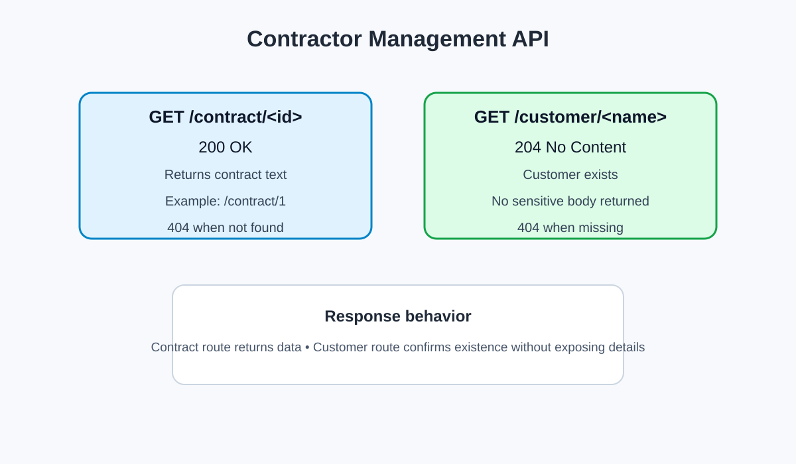

# Contractors Lab

This Flask application exposes two routes that model a contractor management service:

- `/contract/<id>` returns contract details for a valid ID.
- `/customer/<customer_name>` confirms whether a customer exists without returning sensitive data.

The API uses the required HTTP status codes:

- `200` for a successfully found contract
- `204` for a customer match with no data payload
- `404` for a missing record

## Project overview

A contractor company needs to serve two categories of information:

1. Contract records that are safe to return to the requester.
2. Customer records that must be verified without exposing personal data.

This project demonstrates that pattern using a minimal Flask app and a focused test suite.

## Routes

### `GET /contract/<id>`

- Returns the contract text when the ID exists
- Returns `404` when the contract is not found

Example:

- `/contract/1` -> `200` with contract text
- `/contract/999` -> `404`

### `GET /customer/<customer_name>`

- Returns `204` with an empty response body when the customer exists
- Returns `404` when the customer cannot be found

Example:

- `/customer/bob` -> `204`
- `/customer/mario` -> `404`

## Screenshot

## Setup

1. Install dependencies with `pipenv install`
2. Activate the environment with `pipenv shell`
3. Run the app with `python server/app.py`
4. Test the app with `pytest`

## Notes

- The app stores sample data in memory for the lab exercise.
- The customer route intentionally responds with no body to protect sensitive information.
- The code is kept intentionally simple and documented for maintainability.

## Git workflow

The solution is implemented on a feature branch and is ready to be pushed to GitHub for review and merge.
