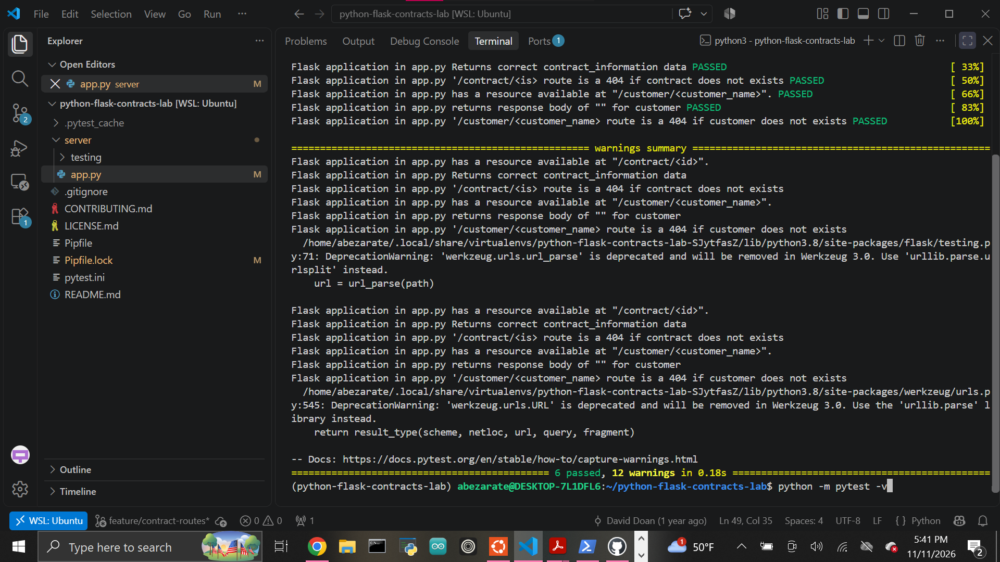

# Lab: Routes Request Response Cycle - Managing Contracts

A Flask application that demonstrates request/response handling, route parameters, HTTP status codes, and protecting sensitive customer data.

## Features

The application includes two routes:

### Contract Route

```text
/contract/<id>
```

If the requested contract ID exists, the application returns the contract information with a `200 OK` response.

Example:

```text
/contract/1
```

Returns:

```text
This contract is for John and building a shed
```

If the contract ID does not exist, the application returns:

```text
404 Not Found
```

### Customer Route

```text
/customer/<customer_name>
```

If the requested customer exists, the application returns:

```text
204 No Content
```

with an empty response body.

This allows the application to confirm that a customer exists without exposing sensitive customer information.

If the customer does not exist, the application returns:

```text
404 Not Found
```

## HTTP Response Codes

This lab uses three important response codes.

### 200 OK

Used when a contract is found successfully.

The response includes the contract information.

### 204 No Content

Used when a customer exists.

The request succeeds, but the application intentionally sends no response body because the customer information is considered sensitive.

### 404 Not Found

Used when a requested contract or customer cannot be found.

## Available Data

The application includes three example contracts:

```python
[
    {
        "id": 1,
        "contract_information": "This contract is for John and building a shed",
    },
    {
        "id": 2,
        "contract_information": "This contract is for a deck for a buisiness",
    },
    {
        "id": 3,
        "contract_information": "This contract is to confirm ownership of this car",
    },
]
```

Available customers:

```python
["bob", "bill", "john", "sarah"]
```

## Project Structure

```text
python-flask-contracts-lab/
├── images/
│   └── tests-passing.png
├── server/
│   ├── app.py
│   └── testing/
│       ├── app_test.py
│       └── conftest.py
├── Pipfile
├── Pipfile.lock
├── pytest.ini
└── README.md
```

## Setup

Install the project dependencies:

```bash
pipenv install
```

Enter the virtual environment:

```bash
pipenv shell
```

The project uses:

```text
Python 3.8.13
```

## Running the Application

From the project root, run:

```bash
python server/app.py
```

The Flask development server runs on port `5555`.

Example contract request:

```text
http://127.0.0.1:5555/contract/1
```

Example customer request:

```text
http://127.0.0.1:5555/customer/bob
```

## Testing

Run the automated test suite:

```bash
python -m pytest -v
```

Current result:

```text
6 passed
```

The tests verify:

- `/contract/<id>` exists
- existing contracts return `200`
- contract information is returned correctly
- missing contracts return `404`
- `/customer/<customer_name>` exists
- existing customers return `204`
- successful customer responses have an empty body
- missing customers return `404`

## Completed Test Suite



## Technologies

- Python
- Flask
- pytest
- Pipenv
- Git
- GitHub

## Key Concept

The main request/response lesson in this lab is that a successful request does not always need to return data.

The customer route uses:

```text
204 No Content
```

to confirm that a customer exists while intentionally protecting sensitive customer information.

## Author

Abraham Zarate